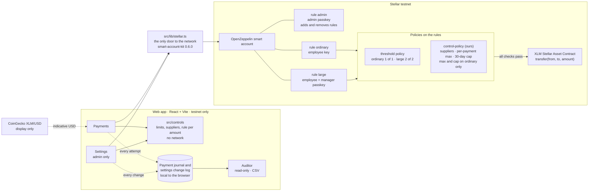

# Arqueo

**Internal controls for stablecoin treasuries, enforced by the account itself.**

Arqueo turns a treasury approval matrix into rules on a Stellar smart account. The account checks who signed, which supplier receives the payment, and whether the amount fits its policy before the transaction can settle.

> **Testnet only.** This demo uses test XLM with no real value. Do not use it to hold or move real funds.

**Live app:** [arqueo-arqueo2.vercel.app](https://arqueo-arqueo2.vercel.app) (testnet only).

Arqueo was built for **HackMeridian 2026 · Genesis · Stellar Composed**. It combines Stellar smart accounts and `smart-account-kit` with OpenZeppelin account policies and a custom Soroban control policy.

## The problem

Small companies and associations often keep treasury funds behind one key. Payment approvals happen in chat, and auditors receive screenshots after the fact. Those processes record decisions, but they do not stop a payment that breaks the policy.

Arqueo puts the authorization rules on the treasury account. An ordinary payment needs the employee signer and must meet the account's supplier and spending controls. A large payment uses a separate rule that requires the employee and manager. The account evaluates the transaction; the web app is not the security boundary.

## How it works



The same diagram, with a reading guide and a table of what the account enforces, is in [docs/architecture.md](docs/architecture.md).

The browser journal records accepted and rejected attempts for this demo. Rejected simulations do not create an on-chain transaction. Accepted rows link to Stellar Expert by transaction hash. The MVP journal is local to the browser; it is not yet reconstructed from chain history.

## Authorization rules

| Rule | Signers | Account controls |
| --- | --- | --- |
| `ordinary` | Employee | Authorized supplier, per-payment maximum, and 30-day spending policy |
| `large` | Employee + manager | Authorized supplier and two signatures |
| `admin` | Admin passkey | Adds or removes account rules and signers |

The app's default demo amounts are 200 XLM, 800 XLM, and 100 XLM. The on-chain account remains authoritative. XLM amounts are converted to stroops (`1 XLM = 10,000,000 stroops`) before contract calls.

## What is in this repository

- `contracts/control-policy/` — Soroban policy contract for supplier allowlists and per-payment limits.
- `app/src/lib/stellar.ts` — the app's only entry point for Stellar network calls.
- `app/src/controls/` — pure TypeScript control-matrix logic and unit tests.
- `app/src/pages/` — landing page, payment screen, and read-only auditor journal.
- `docs/submission/` — pitch deck, demo-video script, and draft submission answers.

### Current demo evidence and limits

- **Ordinary payment:** a 200 XLM employee-signed testnet payment was recorded at ledger 5,385,825. Transaction: [`f7af3add…7ee12a8e`](https://stellar.expert/explorer/testnet/tx/f7af3add0b4141f5caf9ced34c718e5ba7848265dcdb9fbc9520d7077ee12a8e).
- **Large payment:** an 800 XLM employee-only attempt was rejected by `control-policy` error 2; the same amount with employee + manager was accepted at ledger 5,386,036. Transaction: [`03784fdb…63f711d2`](https://stellar.expert/explorer/testnet/tx/03784fdb5d38537fc92f82e30754a942af5204b740b4335937ddd45763f711d2).
- **Supplier rejection:** a 100 XLM payment from the `ordinary` rule to a testnet account outside the supplier list was refused with "Supplier not authorized" (`control-policy` error 1). A refused payment never reaches the chain, so there is no hash; the check and the recipient's unchanged balance are in [docs/evidence-R6-scene3.md](docs/evidence-R6-scene3.md).
- **Auditor:** the app lists payment amount, recipient, concept, date, status, signers, rule, and successful transaction links, including refused attempts. The payments and the settings change log download as CSV.
- **Settings:** the admin changes the per-payment maximum, the 30-day cap and the suppliers with the admin passkey. A cap below what was already spent is refused, and a supplier added or removed takes effect on chain. Evidence: [docs/evidence-R17-settings.md](docs/evidence-R17-settings.md).
- **30-day cap:** the payment screen shows what is left of the cap and, when a payment is refused for the cap, by how much it goes over. Evidence: [docs/evidence-R23-cap.md](docs/evidence-R23-cap.md).
- **Not included yet:** a hosted demo URL, and an audit history rebuilt from the chain (the journal lives in the browser).

The employee signing key is stored in this browser as a demo shortcut. In production, every person should sign with their own passkey on their own device. The kit's default deployer key is derived from a public seed and is for testnet use only; this app uses a separate random testnet deployer key stored in browser storage.

## Run the app on testnet

Requirements: Node.js 22+, npm, Rust/Cargo, Stellar CLI, and Stellar Scaffold CLI.

1. Install the workspace dependencies:

   ```bash
   npm ci
   ```

2. Create the local app environment file:

   ```powershell
   Copy-Item app/.env.example app/.env.local
   ```

3. In `app/.env.local`, configure `PUBLIC_CONTROL_POLICY_ADDRESS` and `PUBLIC_SUPPLIERS` with the deployed testnet policy contract and funded testnet supplier addresses. Keep any private keys in local-only environment files; never commit them.

4. Start the app:

   ```bash
   npm run start --workspace app
   ```

The account and policy addresses in the example environment are for Stellar testnet. Do not change the network passphrase or RPC to point this demo at mainnet.

## Test

```bash
npm test --workspace app
npm run build --workspace app
cargo test --manifest-path contracts/control-policy/Cargo.toml
```

The UI and control tests do not require a wallet or real funds. End-to-end payment tests require testnet configuration and testnet accounts.

## License

Apache-2.0. See [LICENSE](LICENSE).

## Links

- [Live app (testnet only)](https://arqueo-arqueo2.vercel.app)
- [Source repository](https://github.com/Dabuca/arqueo)
- [HackMeridian 2026](https://www.hackmeridian.com/)
- [Stellar testnet explorer](https://stellar.expert/explorer/testnet)
- [Submission materials](docs/submission/README.md)
