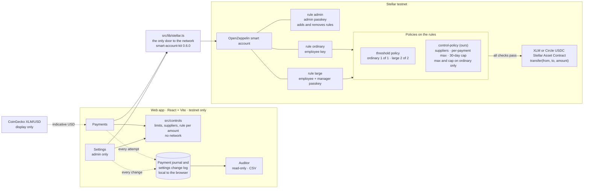
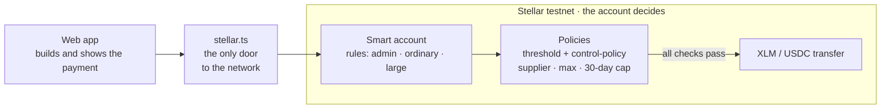

# Architecture

Arqueo has one rule: **the account decides, not the app.** The treasury is an OpenZeppelin smart account on Stellar testnet. Its context rules and policies reject any payment that breaks the controls. The app builds transactions, explains the rules and shows the record.

## How to read it

- **App → `src/controls`.** The controls matrix as pure TypeScript: limits, suppliers, which rule an amount needs, and the settings change log. It never calls the network. The rule it suggests is only a hint for the interface.
- **App → `src/lib/stellar.ts`.** The single door to Stellar. It creates the account, reads state, and builds and signs transactions. A rejection comes back as `{ ok: false, reason }`, not as an exception.
- **Smart account.** Three context rules. `admin` holds the admin passkey and is the only rule that can add or remove rules. `ordinary` is signed by the employee key. `large` needs the employee and the manager. The app picks the rule from who signs.
- **Policies.** OpenZeppelin's threshold policy sets how many signatures a rule needs. Our `control-policy` checks the destination against the supplier list. On `ordinary` it also checks the per-payment maximum and keeps the spent amount of the 30-day period, keyed by account and token contract so XLM and USDC remain independent. `large` carries neither limit: the manager's second signature is its control.
- **Settings changes.** The admin changes limits and suppliers from Settings. The app adds the new rule before it removes the old one, so `ordinary` is never open without its controls. The spent amount and the start of the period survive the change, and the cap can never be set below what was already spent.
- **Token.** The payment screen selects native XLM or Circle USDC on testnet, each moved through its Stellar Asset Contract. Limits use the same numeric values in either asset; each spend counter is independent. Amounts are in seven-decimal stroops.
- **Auditor.** Reads the payment journal, which includes refused attempts, and the settings change log, and exports CSV. In the MVP both logs live in the browser, with the transaction hash for accepted payments; rebuilding them from the chain is future work.
- **USD display.** The XLM/USD toggle uses a public price feed. It changes how amounts are shown and never what is paid or checked.

## What the account enforces, and what the app only shows

| Concern | Enforced on chain | App only |
|---|---|---|
| Supplier must be on the list | `control-policy` | Pre-check hint |
| Per-payment maximum (`ordinary`) | `control-policy` | Pre-check hint |
| 30-day cap and spent amount | `control-policy` | Remaining cap and excess on the payment screen |
| Signatures per rule | threshold policy | Rule suggested from the amount |
| Who may change the rules | `admin` rule | Settings screen |
| USD value of an amount | not involved | Display only |

A refused payment is caught when the transaction is simulated against the account's rules. If it were sent anyway, the network would reject it.

## Condensed version for the deck

The deck uses this shorter view, exported to `docs/architecture-deck.png`. It keeps the same path: app, `stellar.ts`, smart account, policies, XLM transfer.

