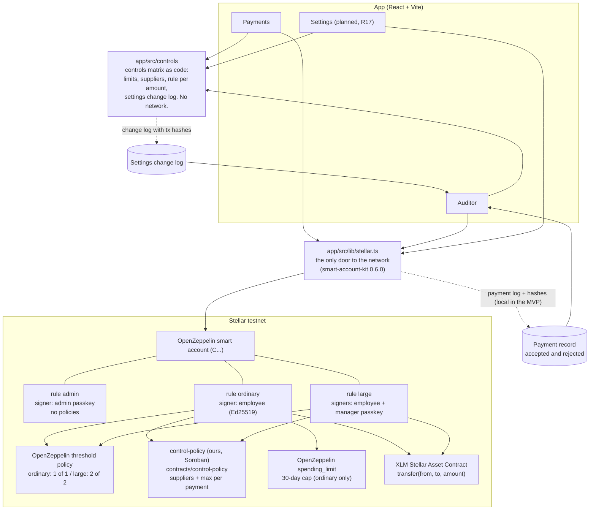

# Architecture

Arqueo has one rule: **the account decides, not the app.** The treasury is an OpenZeppelin smart account on Stellar testnet. Its context rules and policies reject any payment that breaks the controls. The app only builds transactions, explains the rules and shows the record.

## How to read it

- **App → `app/src/controls`.** The controls matrix as pure TypeScript: limits, suppliers, which rule an amount needs, and the settings change log. It never calls the network. The rule it suggests is only a hint for the interface.
- **App → `app/src/lib/stellar.ts`.** The single door to Stellar. It creates the account, reads the balance and signs payments. Rejections come back as `{ ok: false, reason }`, not as exceptions.
- **Smart account.** Three context rules: `admin` (passkey, changes rules), `ordinary` (employee signs), `large` (employee and manager sign). The app picks the rule from who signs.
- **Policies.** OpenZeppelin's threshold policy sets how many signatures are needed. Our `control-policy` checks the destination against the supplier list and the amount against the per-payment maximum. OpenZeppelin's `spending_limit` caps spending over 30 days. The cap may move into `control-policy` (open decision in `AGENTS.md` §3.1).
- **Token.** Native XLM on testnet, moved through its Stellar Asset Contract. Amounts are in stroops (1 XLM = 10,000,000).
- **Auditor.** Reads the payment record, including rejected attempts, and the settings change log, and exports CSV. The MVP record is local plus the transaction hash; rebuilding it from the chain is P1.

## Status

| Piece | Status |
|---|---|
| `app/src/controls` | built (R1) |
| `contracts/control-policy` | built, tested (R5) |
| Company smart account creation and funding in `stellar.ts` | built (R3) |
| `pay`, `listPayments`, `ordinary` / `large` rules | in progress (R4, R7); `pay` and `listPayments` still throw "not implemented" |
| Policy installed in the rules | planned (R6) |
| Payments and Auditor screens | planned (R8, R9) |
| Settings screen | planned (R17) |
